---

##  About Me

I'm a Computer Science student at **Tecnológico de Monterrey** (B.S., Aug 2023 – Dec 2027). I enjoy turning real-world problems into working products, from AI-powered mobile apps to test automation that keeps teams shipping with confidence.

- 🧪 **Software Development Engineer in Test Intern** at **C3 AI**, building end-to-end test automation with Python, TypeScript and Playwright
- 🤖 Interested in **LLM integration, RAG pipelines** and **AI security**
- 🧑‍💻 **IT Coordinator** at SEITC, the Computer Science student society
- 🌎 Spanish (native) · English (B2)

#### My contributions

  <picture>
    <source media="(prefers-color-scheme: dark)" srcset="https://raw.githubusercontent.com/Bryan-Meza/Bryan-Meza/output/pacman-contribution-graph-dark.svg" />
    <source media="(prefers-color-scheme: light)" srcset="https://raw.githubusercontent.com/Bryan-Meza/Bryan-Meza/output/pacman-contribution-graph.svg" />
    
  </picture>

---

##  Experience

**C3 AI** · _Software Development Engineer in Test Intern_ · Aug 2026 – Present

- Own the end-to-end test automation lifecycle for a QA automation dashboard, from analysis and documentation to implementation, and define test automation strategies adopted across the team
- Integrate automated tests into CI/CD pipelines for real-time execution tracking and full traceability of QA results

**CEMEX** · _IT Operations & Architecture Intern (P&IT)_ · Aug 2025 – Feb 2026

- Led AI security research for the Security Architecture Definition project, evaluating LLM threat models, prompt injection risks and secure AI integration patterns
- Evaluated and classified OT cybersecurity risks against industry standards and streamlined incident reporting workflows

---

##  Featured Projects

### ☕ Machtia · _Oct – Dec 2025_

Accessible mobile learning app for coffee growers with limited tech experience.

- Supabase backend (auth + REST API) with SwiftData local storage, keeping progress and content in sync across devices
- AI-powered admin panel: instructors submit YouTube videos that are chunked, transcribed and indexed into a vector store to power a **RAG chatbot**

`SwiftUI` `SwiftData` `Supabase` `LLM` `Python`

### 💰 Cappie · HackMTY 2025 · _Oct 2025_

AI personal finance coach built at Mexico's largest hackathon.

- LLM-driven natural-language spending analysis and personalized savings goals
- SwiftUI app on a FastAPI + MySQL backend with real-time insights and budget recommendations

`SwiftUI` `FastAPI` `LLM` `MySQL`

### 🎮 Gamified Training System · _Mar – Jun 2025_

Gamified employee training platform for **OXXO**.

- Unity interactive modules backed by an ASP.NET REST API, with achievement systems and real-time progress dashboards

`ASP.NET` `Unity` `MySQL`

---

##  Tech Stack

**Languages** 

**Frameworks & Web** 

**Tools & Cloud** 

**AI & Testing** &nbsp;

**Also** &nbsp;

---

##  Certifications

- Oracle Cloud Infrastructure 2025 Foundations Associate
- Oracle Cloud Infrastructure 2025 AI Foundations Associate
- CCNA: Introduction to Networks
- Foundations of Cybersecurity

---

##  GitHub Stats

  
  
   
  

---

**Let's connect.** I'm always happy to talk about software, AI or new opportunities.
Reach me at [bryan.albertolemus9@gmail.com](mailto:bryan.albertolemus9@gmail.com) or on [LinkedIn](https://www.linkedin.com/in/bryan-meza).

